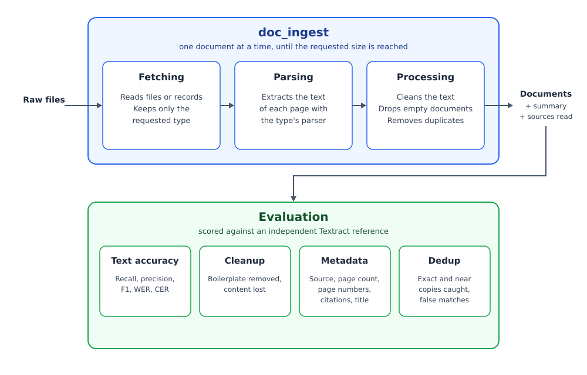

# Document Ingestion Engine

A pluggable Python library that turns raw files into clean, deduplicated documents, one document per file in a single output format. It can be imported into any Python project or run as a standalone command-line tool.

## Features

- **Built on LangChain:** uses LangChain's document parsers underneath.
- **Text cleanup:** removes repeated headers and footers, extra whitespace and stray characters.
- **Deduplication:** removes exact and near-duplicate documents.
- **Skips blank documents:** totally empty documents are never processed or returned.
- **Returns the requested count:** keeps reading past skipped documents until it has the number of documents asked for, or the source runs out.
- **Measured accuracy and quality:** text accuracy, cleanup, metadata and deduplication are evaluated against an independent reference and compared with plain LangChain.
- **Compared with LangChain:** on 100 DUDE PDFs, F1 0.82 vs 0.78, word error rate 0.59 vs 0.64, character error rate 0.46 vs 0.52.

## Installation

Requires Python 3.10 or later.

```bash
pip install git+https://github.com/tanzima-sultana/doc_ingest_engine.git
```

### Quick start

```python
from doc_ingest import ingest_documents

result = ingest_documents("path/to/folder", size=50, document_type="pdf")

for document in result.documents:
	print(document.source, len(document.pages))
```

### Command line

```bash
python -m doc_ingest --path path/to/folder --size 50 --document_type pdf
```

## API

```python
ingest_documents(path, size, document_type, settings=None) -> IngestResult
```

- **path:** a local file or folder.
- **size:** the number of documents to return.
- **document_type:** the type of documents to keep, e.g. `pdf`.
- **settings:** optional `Settings(dedup_threshold=0.90, timeout_seconds=120)`.

`IngestResult` has:

- **documents:** the returned documents.
- **summary:** counts for each step of the run.
- **sources_read:** every source that was read, including the skipped ones.

Invalid input raises `IngestError`. A document that fails is skipped and the run continues.

## Output Format

The output format `Document` is a Pydantic model:

```python
class Page(BaseModel):
	number: int        # page number, from 1
	text: str          # cleaned text of the page ("" for a page with no text)

class Document(BaseModel):
	id: str                    # unique id made from the file's content
	type: DocumentType         # e.g. DocumentType.PDF
	source: str                # path of the original file
	title: str | None          # title, if it has one
	pages: list[Page]          # pages in order

	@property
	def text(self) -> str: ... # all non-empty pages joined with a blank line
```

A returned one looks like this:

```python
Document(
	id="3f9a1c0e8b2d4a71",
	type=DocumentType.PDF,
	source="path/to/folder/report.pdf",
	title="Annual Report",
	pages=[
		Page(number=1, text="Annual Report ..."),
		Page(number=2, text=""),
		Page(number=3, text="Financial summary ..."),
	],
)
```

## Architecture



## Evaluation

## Results

## Limitations

## Work in Progress
